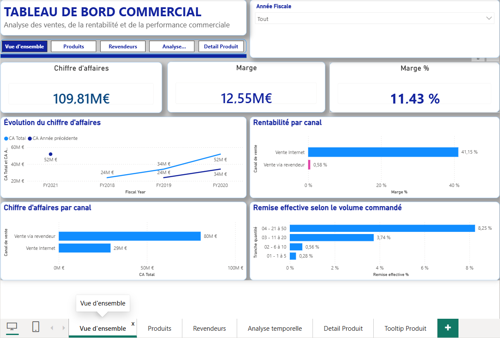
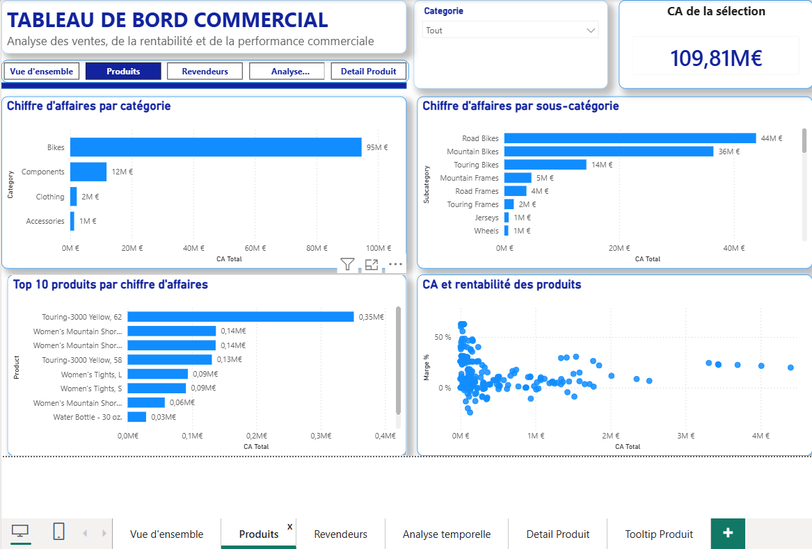
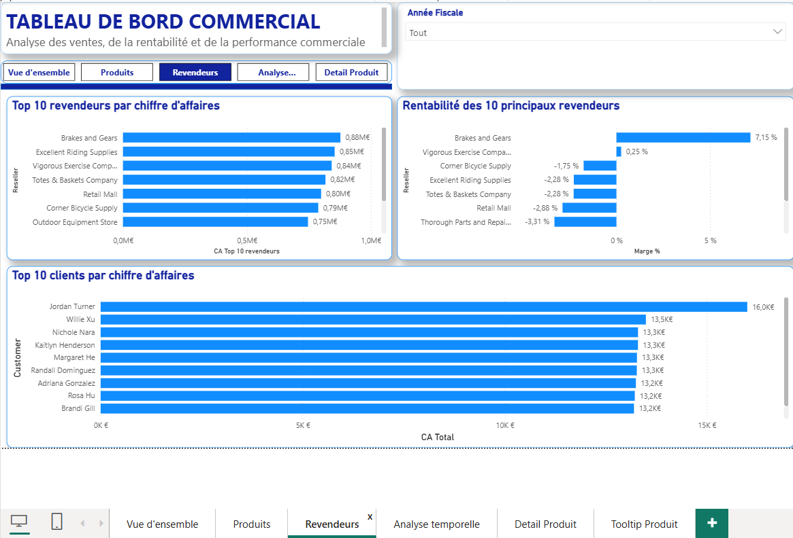

# AdventureWorks Sales — Tableau de bord commercial avec Power BI

## Présentation du projet

Ce projet consiste à transformer des données commerciales issues du jeu de données AdventureWorks Sales en un tableau de bord interactif réalisé avec **Microsoft Power BI**.

L’objectif est de fournir une vision claire de la performance commerciale de l’entreprise : évolution du chiffre d’affaires, rentabilité, performances des canaux de vente, analyse des produits et comportement des remises.

Ce projet m’a permis de travailler sur les différentes étapes d’un projet de Business Intelligence, de la préparation des données jusqu’à la restitution des résultats sous forme de visualisations interactives.

## Objectifs

- Explorer et comprendre la structure des données commerciales.
- Nettoyer et enrichir les données avec Power Query.
- Construire un modèle de données en étoile.
- Créer des mesures DAX pour calculer les principaux indicateurs commerciaux.
- Concevoir un tableau de bord interactif adapté à l’analyse métier.
- Identifier les principaux enseignements à partir des données.

## Outils et technologies

- **Microsoft Power BI Desktop** — modélisation, mesures et visualisations
- **Power Query** — préparation et transformation des données
- **DAX** — calcul des indicateurs et analyse temporelle
- **Microsoft Excel** — fichier source des données

## Démarche du projet

### 1. Cadrage et exploration des données
Analyse de la structure du jeu de données, identification de la table de faits et des tables de dimensions, puis premières vérifications de qualité.

### 2. Nettoyage et enrichissement
Préparation des données dans Power Query, vérification des types de données, ajout d’informations utiles à l’analyse et contrôle des valeurs particulières.

### 3. Modélisation des données
Construction d’un modèle en étoile, définition des relations entre les tables et mise en place d’une table de dates pour les analyses temporelles.

### 4. Création des indicateurs
Développement de mesures DAX pour analyser notamment :
- le chiffre d’affaires total ;
- la marge et le taux de marge ;
- l’évolution des ventes dans le temps ;
- les performances des canaux de vente ;
- les remises et leur relation avec les volumes commandés.

### 5. Conception du tableau de bord
Création de pages d’analyse, choix des visualisations, mise en forme cohérente et ajout de fonctionnalités interactives pour faciliter l’exploration des résultats.

## Principaux constats métier

L’analyse a notamment mis en évidence les points suivants :

- **Le canal revendeur génère la majorité du chiffre d’affaires**, avec environ 80,45 millions d’euros, contre 29,36 millions d’euros pour le canal Internet.
- **Le taux de marge diffère fortement selon le canal** : environ 0,58 % pour les ventes via revendeurs et 41,15 % pour les ventes Internet, selon les mesures retenues dans le modèle.
- **La remise effective calculée augmente avec le volume commandé**, ce qui invite à approfondir l’analyse des politiques de remise.

Ces résultats illustrent l’intérêt de ne pas se limiter au chiffre d’affaires pour évaluer la performance commerciale. Ils doivent être interprétés en tenant compte des définitions des indicateurs et du périmètre des données.

## Résultat

Le livrable principal est un rapport Power BI interactif permettant d’explorer les performances commerciales selon différentes dimensions et périodes.

## Aperçu du tableau de bord

### Vue générale

### Analyse commerciale

### Analyse des produits

## Compétences mobilisées

- Business Intelligence et analyse commerciale
- Préparation et contrôle de la qualité des données
- Modélisation dimensionnelle
- DAX et création de KPI
- Visualisation de données
- Analyse et interprétation des résultats métier

## Contexte

Projet individuel réalisé dans le cadre d’un travail pratique de formation à Power BI, à partir du jeu de données AdventureWorks Sales.

---

*Projet de portfolio — Data Analytics / Business Intelligence.*
